# PHiscord

PHiscord is a Discord-inspired desktop chat app for small communities. Create a server for your group, talk in shared text and voice channels, or carry on a one-to-one conversation. The app uses Electron and Next.js, with Firebase for accounts, messages, files, and presence, and Agora for calls.

The screenshots show the app's actual browser interface in its built-in dark mode. Orbit Club, the profiles, messages, attachment, and friend request are fictional. A local demo simulated sign-in, Firebase reads and writes, presence, and the call connection. The call screenshot shows the controls without a live participant or media stream.

## Sign in and register

Sign in with an email and password or create an account with a username and display name.

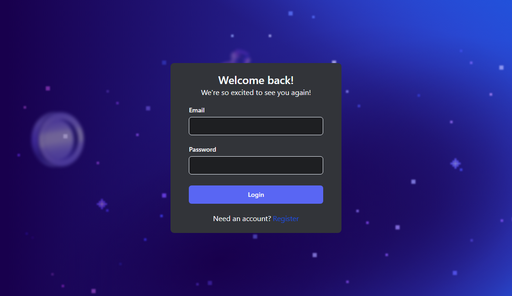

The sign-in page offers email and password fields and a link to registration.

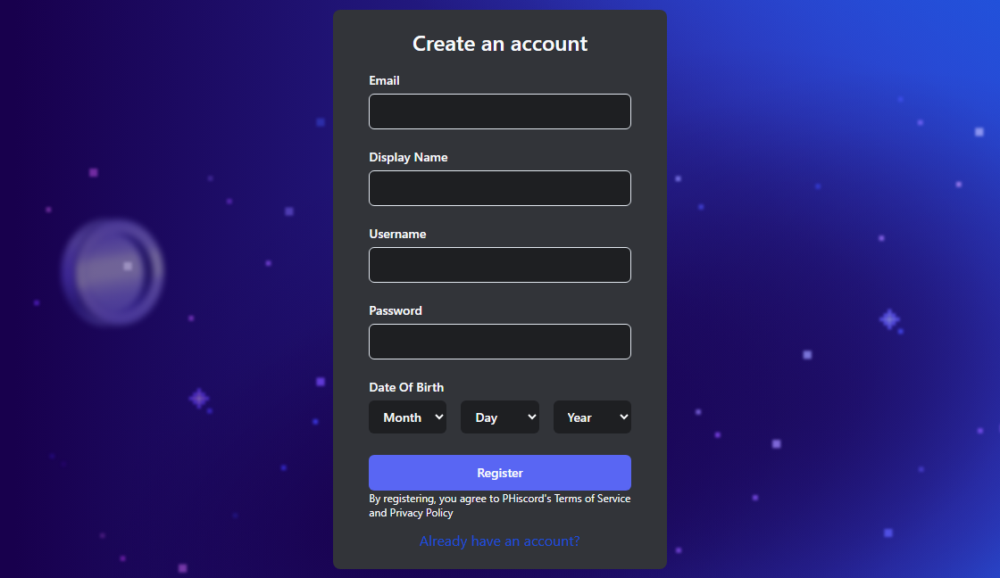

The registration form collects account details before creating a profile.

## Friends and presence

See which friends are online, browse your full friend list, manage blocked users, and send friend requests by user ID.

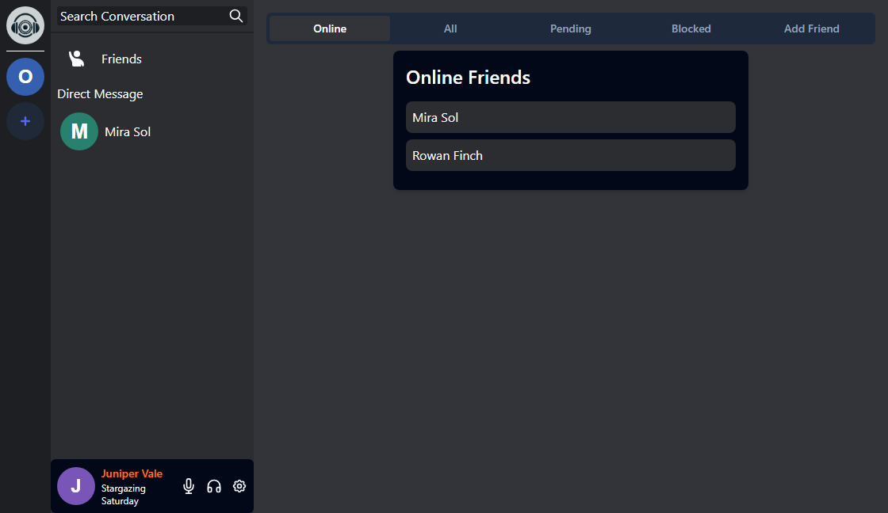

The Online tab lists friends currently marked online and lets you open a conversation.

### Respond to a friend request

Open **Pending** to accept or reject an incoming request. Accepting adds both accounts to each other's friend lists.

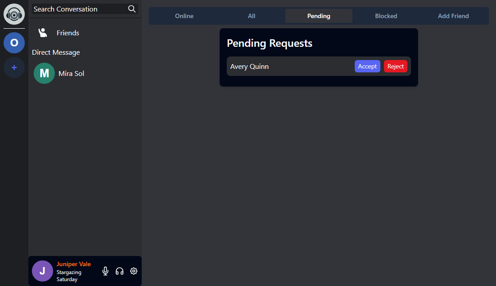

The Pending tab shows a fictional incoming request before a response is selected.

## Direct messages

Open a conversation from the sidebar or friend list. Send text, emoji, and attachments, search the conversation, or start a private call using the phone icon.

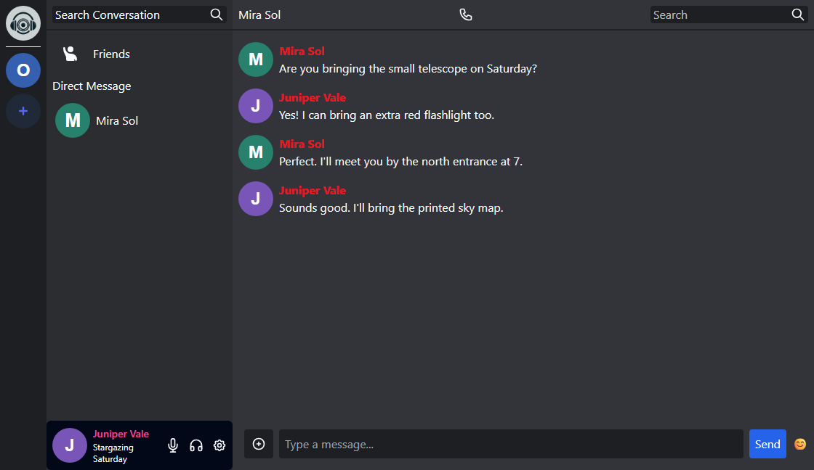

The conversation with Mira shows the call and search controls above the message history and the composer below it.

## Servers and channels

Use the **+** in the server rail to create a server or join one with an invite from its settings. New servers start with a General text channel and a General voice channel. Owners and admins can add more channels.

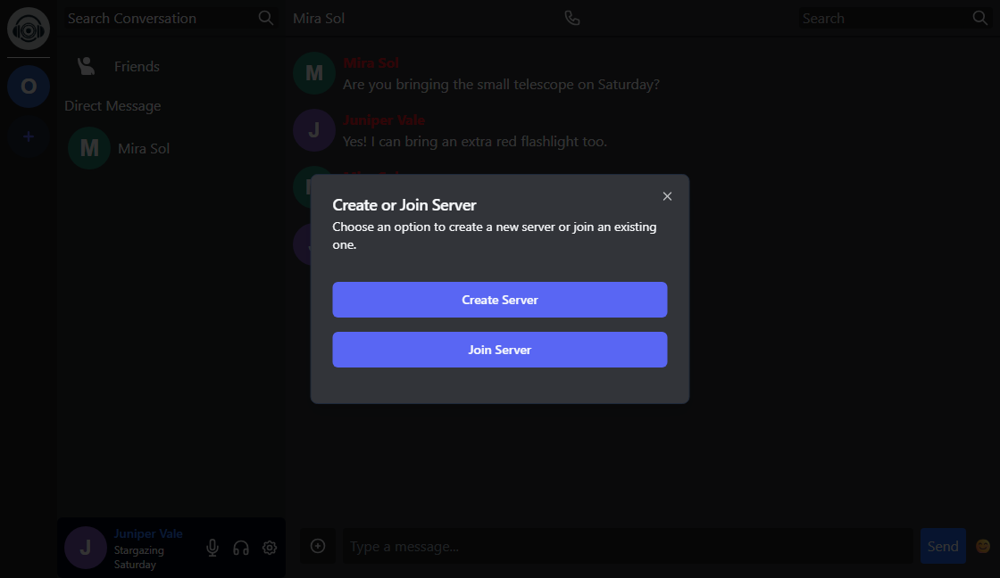

The server dialog offers separate paths for creating a server and joining with an invite.

### Server text chat

Use text channels to keep group conversations organized. Send messages and attachments, mention members, search the channel, and edit or delete your own messages.

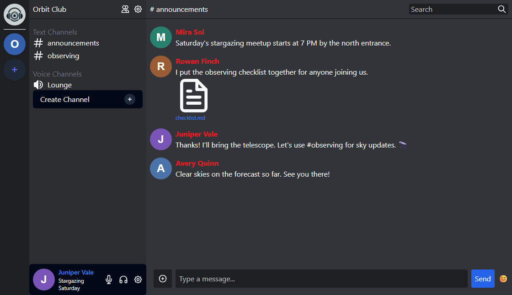

The announcements channel shows a group conversation with a checklist attachment, a search box, and a message composer.

### Server roles

Server owners can promote members to admin or return them to the member role. Server settings also provide an invite and a per-server nickname.

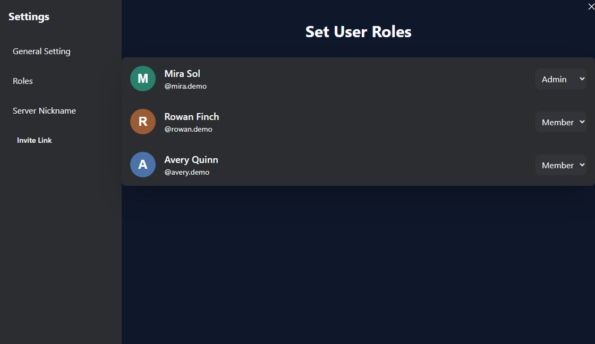

The role editor shows the owner’s controls for changing each member’s role.

## Voice and video calls

Join a server voice channel or place a call from a direct message. The call screen provides microphone mute, deafen, camera, and leave controls.

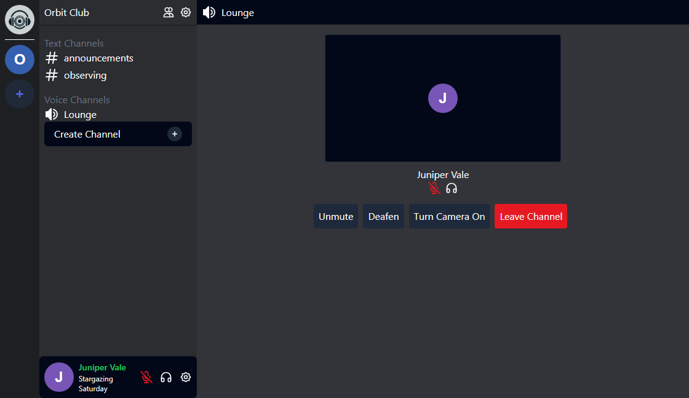

The simulated call shows the local avatar alongside the Unmute, Deafen, Turn Camera On, and Leave Channel controls.

## Profile and appearance

Update your profile picture, display name, and status in General Settings. Appearance Settings contains the theme toggle and a chat font-size control.

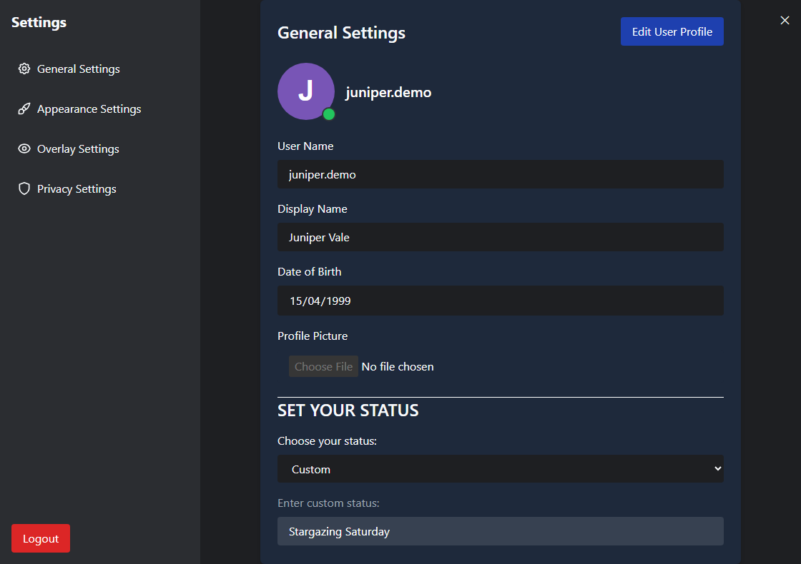

General Settings shows the demo profile and its custom stargazing status.

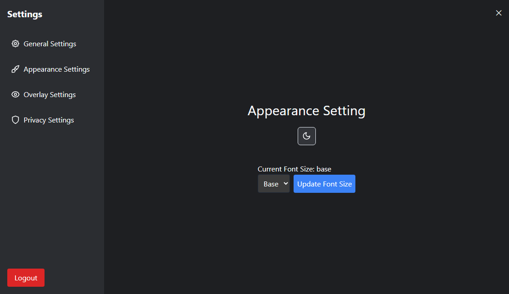

Appearance Settings shows the controls for switching themes and choosing a chat font size.

## Current limitations

- Polls and voting have no implementation or screen in this version.
- The channel creation dialog mentions screen sharing, but the call screen implements audio and camera controls only.
- Privacy Settings saves stranger-message and stranger-call preferences, but the message and call handlers do not apply them.
- The Windows jump list exposes a Disconnect entry, but the renderer has no handler for it. Use the in-call leave button to leave a call.
- The floating overlay depends on Electron, and its window is created in desktop development mode. The overlay and native tray controls were checked in source because a browser capture cannot show those windows.
- The registration notice displays Terms of Service and Privacy Policy as plain text, and the standalone About route contains starter-template content.

## Run locally

With Node.js and npm installed, run these commands from the repository root.

```sh
npm install --package-lock=false
npm run dev
```

`npm run dev` starts Nextron and the Agora token service on port 3001. For a live environment, configure your own Firebase project in `renderer/firebase/firebaseApp.ts` with email/password authentication, Firestore, Realtime Database, and Storage. Calls also need a matching Agora App ID in the renderer and the corresponding Agora configuration for the token service in `agoraToken.js`.
